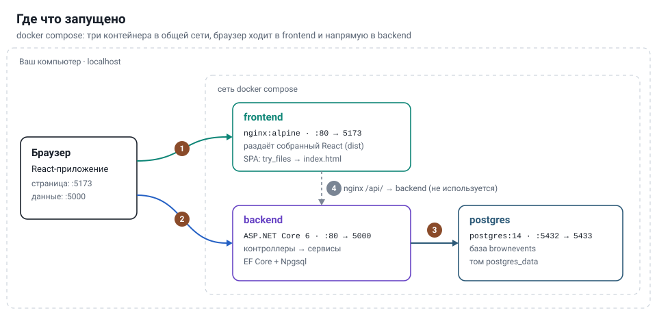
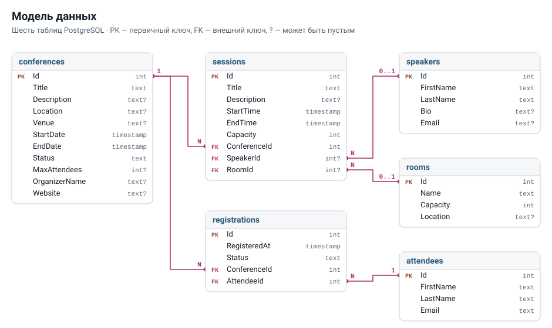
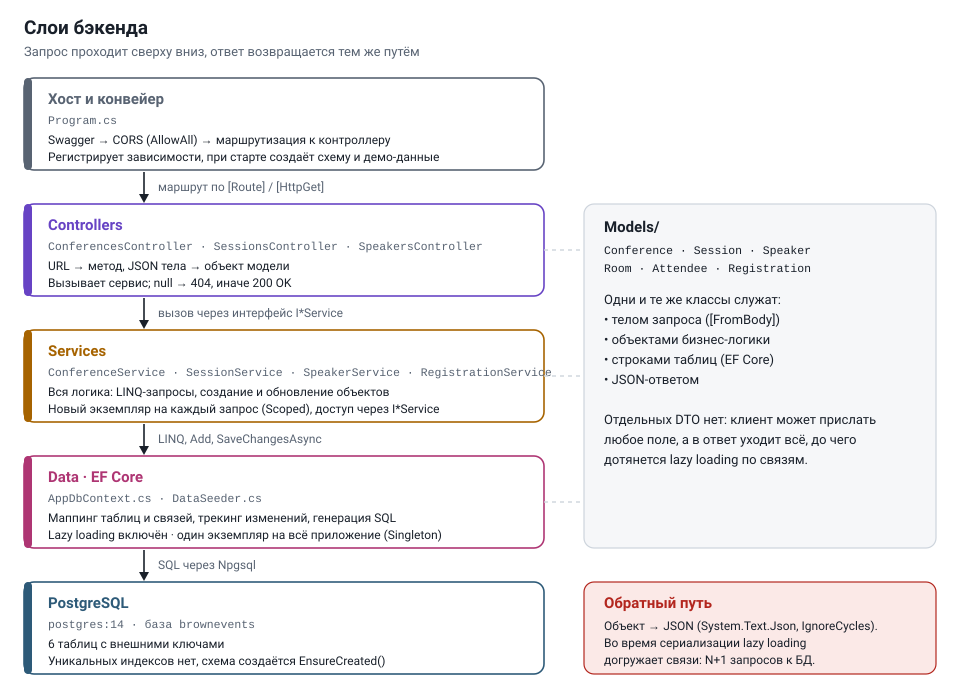
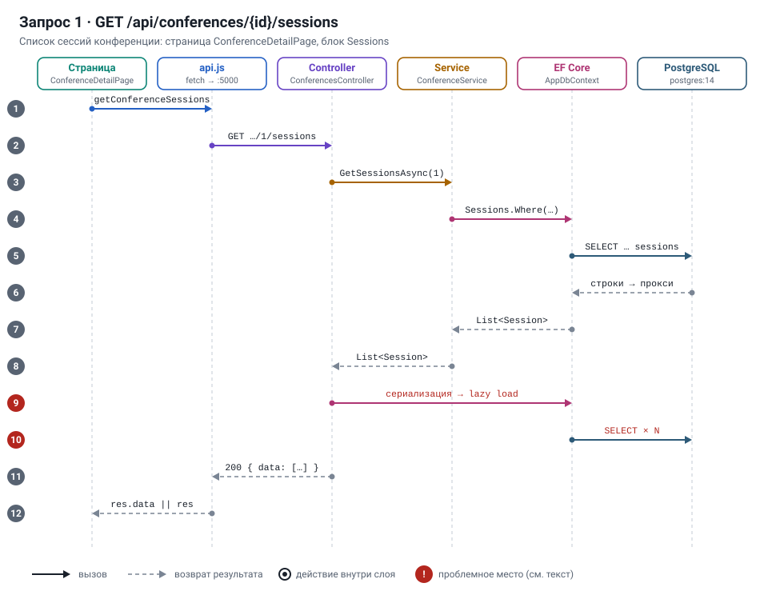
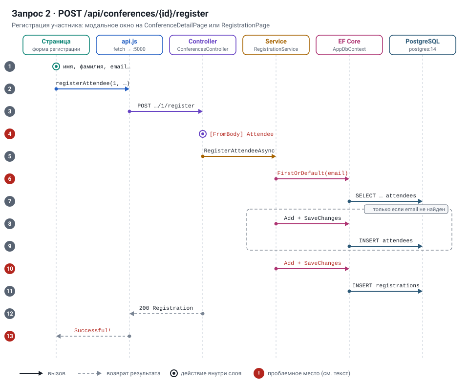
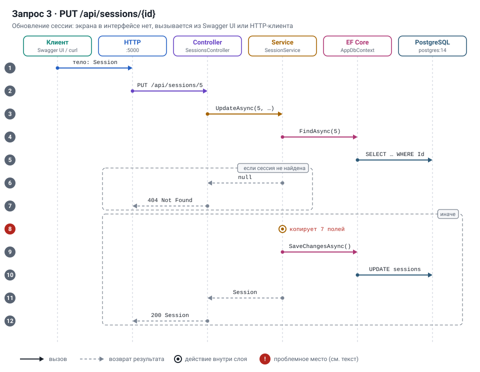

# Архитектура бэкенда

Бэкенд — ASP.NET Core Web API (`backend/BrownEvents.Api`), EF Core + PostgreSQL. Код читался вручную; всё ниже сверено с исходниками, ссылки на файлы даны в таблицах. Схемы лежат в [docs/diagrams/](diagrams/) как SVG и открываются в любом просмотрщике Markdown.

**Стек** ([BrownEvents.Api.csproj](../backend/BrownEvents.Api/BrownEvents.Api.csproj), [Dockerfile](../backend/BrownEvents.Api/Dockerfile)): .NET 6 (`net6.0`, образы `sdk:6.0` / `aspnet:6.0`), EF Core 6.0.25 + `EntityFrameworkCore.Proxies` (lazy loading), Npgsql.EntityFrameworkCore.PostgreSQL 6.0.22 с включённым `Npgsql.EnableLegacyTimestampBehavior`, Swashbuckle 6.5.0 + Swashbuckle.AspNetCore.Filters 7.0.12 (примеры в Swagger). Тесты — xUnit + EF Core InMemory.

**Документация API** (BEVN-002): Swagger UI на `/swagger`. Описания берутся из XML-комментариев контроллеров и моделей (`GenerateDocumentationFile`), коды ответов — из `[ProducesResponseType]`, примеры тел и ответов — из [Swagger/Examples/](../backend/BrownEvents.Api/Swagger/Examples/), общее описание API — из [Swagger/ApiDocumentation.cs](../backend/BrownEvents.Api/Swagger/ApiDocumentation.cs). Документация описывает фактическое поведение, включая особенности из раздела «Наблюдения» ниже; при изменении поведения эндпоинта её нужно обновлять вместе с кодом.

## Состав системы

1. Браузер открывает `localhost:5173`. nginx отдаёт `index.html` и собранный JS. На любой путь (например `/conferences/1`) он возвращает тот же `index.html`, а нужную страницу выбирает React Router уже в браузере.
2. За данными React идёт через [api.js](../frontend/src/api.js), где жёстко прописан `http://localhost:5000`. Это другой origin, поэтому срабатывает CORS. Бэкенд разрешает всё (`AllowAll`).
3. Бэкенд подключается к базе по имени сервиса `postgres:5432` внутри сети compose. С вашего компьютера та же база доступна на `localhost:5433`.
4. В [nginx.conf](../frontend/nginx.conf) настроено проксирование `/api/` на бэкенд, но оно не используется, потому что `api.js` указывает полный адрес.

Контейнеры описаны в [docker-compose.yml](../docker-compose.yml). Строка подключения лежит в [appsettings.json](../backend/BrownEvents.Api/appsettings.json) и переопределяется переменной `ConnectionStrings__DefaultConnection` в compose. В обоих местах хост `postgres:5432`. Для `dotnet run` вне Docker строку нужно переопределить на `localhost:5433`: в `appsettings.Development.json` её нет, там только уровни логирования, включая SQL-команды EF.

## ER-диаграмма

Источник: [Models/](../backend/BrownEvents.Api/Models/) и [Data/AppDbContext.cs](../backend/BrownEvents.Api/Data/AppDbContext.cs). Таблицы называются в нижнем регистре во множественном числе.

| Связь | Кратность | Внешний ключ |
|---|---|---|
| conferences → sessions | 1 : N | `sessions.ConferenceId`, обязательный |
| conferences → registrations | 1 : N | `registrations.ConferenceId`, обязательный |
| attendees → registrations | 1 : N | `registrations.AttendeeId`, обязательный |
| speakers → sessions | 0..1 : N | `sessions.SpeakerId`, nullable |
| rooms → sessions | 0..1 : N | `sessions.RoomId`, nullable |

`Registration` фактически — связующая таблица «многие ко многим» между `Conference` и `Attendee` с собственным `Id` и атрибутами (`RegisteredAt`, `Status`). Уникальных индексов в модели нет: ни на `Attendees.Email`, ни на пару `(ConferenceId, AttendeeId)`. `Status` у конференции (по умолчанию `UPCOMING`) и у регистрации (по умолчанию `CONFIRMED`) — строки, не enum.

## Слои

| Слой | Файлы | Ответственность | Зависит от |
|---|---|---|---|
| Хост / композиция | [Program.cs](../backend/BrownEvents.Api/Program.cs) | DI, JSON (`IgnoreCycles`), CORS `AllowAll`, Swagger, `EnsureCreated()` + сидинг при старте | всё ниже |
| Controllers | [Controllers/](../backend/BrownEvents.Api/Controllers/) — `Conferences`, `Sessions`, `Speakers` | Маршруты `api/...`, биндинг `[FromBody]` прямо в сущности EF, маппинг `null` → `404`, ответ `Ok(...)` (в том числе на `POST`, а не `201`). Атрибута `[ApiController]` нет, поэтому автоматического `400` при невалидной модели тоже нет | интерфейсы сервисов, Models |
| Services | [Services/](../backend/BrownEvents.Api/Services/) — `I*Service` + реализации (Scoped) | Вся бизнес-логика и доступ к данным: LINQ-запросы, `Add`/`SaveChangesAsync`, копирование полей при `Update` | `AppDbContext`, Models |
| Data | [Data/AppDbContext.cs](../backend/BrownEvents.Api/Data/AppDbContext.cs), [DataSeeder.cs](../backend/BrownEvents.Api/Data/DataSeeder.cs) | `DbSet`-ы, маппинг таблиц и FK; демо-данные (3 спикера, 4 комнаты, 3 конференции, 7 сессий), если `Conferences` пуст | Models, Npgsql |
| Models | [Models/](../backend/BrownEvents.Api/Models/) | Сущности EF; они же служат входными и выходными DTO (отдельных DTO нет) | — |
| Tests | [BrownEvents.Tests/](../backend/BrownEvents.Tests/) | Юнит-тесты `ConferenceService` (5 тестов) и `SessionService` (2 теста) на EF InMemory, без lazy-прокси, проверки FK и Npgsql. Поведение продовой конфигурации тесты не воспроизводят | Services, Data |

Отдельного репозиторного слоя нет — сервисы работают с `AppDbContext` напрямую. `RegistrationService` не имеет своего контроллера: его вызывает `ConferencesController.Register`. `SpeakerService` и `SpeakersController` покрывают только `GET` и `POST` списка.

### Эндпоинты

| Метод | Путь | Сервис |
|---|---|---|
| GET / POST | `/api/conferences` | `ConferenceService.GetAllAsync` / `CreateAsync` |
| GET / PUT | `/api/conferences/{id}` | `GetByIdAsync` / `UpdateAsync` |
| GET / POST | `/api/conferences/{id}/sessions` | `GetSessionsAsync` / `AddSessionAsync` (ответ обёрнут в `{ data }`) |
| GET | `/api/conferences/{id}/registrations` | `GetRegistrationsAsync` |
| POST | `/api/conferences/{id}/register` | `RegistrationService.RegisterAttendeeAsync` |
| GET / PUT | `/api/sessions/{id}` | `SessionService.GetByIdAsync` / `UpdateAsync` |
| GET / POST | `/api/speakers` | `SpeakerService.GetAllAsync` / `CreateAsync` |

## Сквозные запросы

На схемах шесть дорожек — слои, через которые проходит запрос. Сплошная стрелка — вызов, пунктирная — возврат результата, кружок — действие внутри одного слоя. Красным номером отмечены проблемные шаги. Номера в тексте под схемой совпадают с номерами шагов на ней.

### 1. Список сессий конференции — `GET /api/conferences/{id}/sessions`

1. `ConferenceDetailPage` при открытии вызывает `getConferenceSessions(id)` из `api.js` (параллельно с запросами конференции и регистраций).
2. `fetch` на `http://localhost:5000/api/conferences/1/sessions`. Маршрутизация выбирает `ConferencesController.GetSessions`.
3. Контроллер вызывает `ConferenceService.GetSessionsAsync(1)`.
4. Сервис строит запрос `_context.Sessions.Where(s => s.ConferenceId == conferenceId).ToListAsync()`.
5. EF Core отправляет SQL: `SELECT … FROM sessions WHERE "ConferenceId" = @p`.
6. EF превращает строки в объекты. Из-за `UseLazyLoadingProxies()` это прокси-наследники `Session`, которые умеют догружать связи.
7. Список возвращается в сервис.
8. Сервис отдаёт его контроллеру, тот оборачивает в `Ok(new { data = sessions })`.
9. **Проблема.** При сериализации System.Text.Json читает навигационные свойства каждой сессии, и каждое чтение запускает ленивую загрузку. `IgnoreCycles` обрывает только ссылки на объекты, которые уже есть на текущем пути обхода, поэтому в JSON попадут:
   - `speaker` и `room`;
   - `conference`, а внутри неё все `sessions` этой конференции (текущая выводится как `null`, иначе был бы цикл) и все `registrations`, у каждой из которых есть `attendee` с `email`.
10. **Проблема.** Это N+1: по отдельному SQL-запросу на каждую ещё не загруженную связь.
11. Ответ `200 { "data": [ … ] }`. Это единственный GET, который заворачивает ответ в `data`.
12. `api.js` разворачивает его через `res.data || res`. `SessionCard` показывает спикера и зал, то есть интерфейс зависит от ленивой загрузки.

Итог: N+1 запросов к БД, ответ, который растёт как «сессии × сессии», и раскрытие персональных данных участников через публичный эндпоинт. Так же ведут себя `GET /api/conferences`, `GET /api/conferences/{id}` и `GET /api/conferences/{id}/registrations`: любой ответ с сущностью тянет за собой весь достижимый граф.

### 2. Регистрация участника — `POST /api/conferences/{id}/register`

1. Пользователь заполняет форму: модальное окно Register Now в `ConferenceDetailPage` или страницу `RegistrationPage`. Обязательность имени, фамилии и email проверяет только браузер (`required`).
2. Вызов `registerAttendee(id, formData)`. Кроме `firstName`, `lastName`, `email` форма отправляет `phone`, `company`, а модальное окно ещё `dietaryRequirements` и `sessionId`.
3. `POST /api/conferences/1/register` с JSON-телом попадает в `ConferencesController.Register`.
4. **Проблема.** `[FromBody] Attendee`: у `Attendee` есть только `FirstName`, `LastName`, `Email`, поэтому остальные поля молча отбрасываются. Валидации нет: пустой email тоже пройдёт.
5. Контроллер вызывает `RegistrationService.RegisterAttendeeAsync(1, attendee)`.
6. **Проблема.** Поиск участника синхронным `Attendees.FirstOrDefault(a => a.Email == …)`: поток ждёт ответа БД.
7. SQL: `SELECT … FROM attendees WHERE "Email" = @p LIMIT 1`.
8. Только если участник не найден: `Attendees.Add(attendeeData)` и сразу `SaveChangesAsync()`, чтобы получить `Id`. Если найден, берётся существующий, а имя и фамилия из формы игнорируются.
9. SQL: `INSERT INTO attendees … RETURNING "Id"`.
10. **Проблема.** Создаётся `Registration { ConferenceId, AttendeeId, RegisteredAt = UtcNow, Status = "CONFIRMED" }` и второй `SaveChangesAsync()`, без общей транзакции с шагом 8. Не проверяется ничего: существование конференции (несуществующий `id` даст нарушение FK и `500`), повторная регистрация (создастся вторая запись), лимит `MaxAttendees`. В `RegistrationService` на этом месте остался пустой комментарий `//`.
11. SQL: `INSERT INTO registrations … RETURNING "Id"`.
12. Ответ `200` с `Registration`. Он создан через `new` и прокси не является, но после `SaveChanges` EF проставляет ссылки на уже отслеживаемые объекты: `attendee` всегда, а `conference` — если она уже загружена в общий контекст. Тогда в ответ уходит и весь граф конференции, как в запросе 1.
13. **Проблема.** Интерфейс показывает «Registration Successful!» и обещает письмо-подтверждение, но отправки писем в бэкенде нет. Модальное окно не перезагружает список регистраций.

### 3. Обновление сессии — `PUT /api/sessions/{id}`

1. Экрана редактирования в интерфейсе нет, поэтому запрос отправляется из Swagger UI (`http://localhost:5000/swagger`) или HTTP-клиента. Тело — объект `Session`.
2. `PUT /api/sessions/5` попадает в отдельный контроллер `SessionsController.Update`.
3. Контроллер вызывает `SessionService.UpdateAsync(5, session)`.
4. Сервис ищет запись через `await _context.Sessions.FindAsync(id)`. FindAsync сначала смотрит в трекер общего контекста.
5. SQL отправляется, только если сессии нет в трекере: `SELECT … FROM sessions WHERE "Id" = @p LIMIT 1`.
6. Если сессия не найдена, сервис возвращает `null`.
7. Контроллер отвечает `404 Not Found`.
8. **Проблема.** Иначе сервис копирует в найденный объект 7 полей: `Title`, `Description`, `StartTime`, `EndTime`, `Capacity`, `SpeakerId`, `RoomId` (`ConferenceId` не меняется). Это полная замена: поле, которого нет в JSON, станет пустым. Проверок нет: пересечение времени в одном зале, `EndTime > StartTime`, превышение `Capacity` зала, существование `SpeakerId`/`RoomId` (плохой FK → `500`).
9. `SaveChangesAsync()`: трекер сравнивает объект со снимком и находит изменённые свойства.
10. SQL: `UPDATE sessions SET … WHERE "Id" = @p`, только по изменённым колонкам.
11. Сервис возвращает обновлённый `Session`.
12. Ответ `200` с сессией (при сериализации снова догружается граф, как в запросе 1).

## Наблюдения для будущих задач

Это факты о текущем коде, не исправления — в рамках BEVN-001 код не менялся.

- **`AppDbContext` зарегистрирован как Singleton** ([Program.cs:11](../backend/BrownEvents.Api/Program.cs#L11)), а сервисы — Scoped. Один контекст на все запросы: он не потокобезопасен, а его change tracker копит сущности между запросами. При этом `ConferenceDetailPage` шлёт три запроса параллельно, и все они попадают в этот контекст. Кроме того, отслеживаемые объекты не перечитываются, поэтому изменения, сделанные в БД мимо приложения, не видны до перезапуска.
- **Фронтенд опирается на ленивую загрузку**: `SessionCard` и `SessionDetailPage` показывают `speaker` и `room`, а список регистраций — `attendee`. Эти данные приходят только как побочный эффект сериализации прокси. Если отключить lazy loading и не заменить его на `Include` или DTO, эти блоки опустеют.
- **nginx- и Vite-прокси для `/api` не используются**: `api.js` обращается по абсолютному `http://localhost:5000`, поэтому браузер идёт прямо в бэкенд через CORS, а `proxy_pass` в [nginx.conf](../frontend/nginx.conf) и `server.proxy` в [vite.config.js](../frontend/vite.config.js) не задействованы. Заголовок `Content-Type: application/json` на всех запросах вызывает CORS-preflight даже для GET.
- **Синхронное ожидание в async-коде**: `.FindAsync(id).Result` в `ConferenceService.GetByIdAsync`/`UpdateAsync` и `SessionService.GetByIdAsync`, `FirstOrDefault` в `RegistrationService`.
- **Сущности EF как API-контракт**. На вход клиент может прислать любые поля, включая `Id` и навигационные свойства. На выход lazy loading сериализует весь граф объектов, включая email участников (подробно в запросе 1).
- **`Status` нормализуется непоследовательно**: `UpdateAsync` приводит его к верхнему регистру, а `CreateAsync` сохраняет как есть. Значение `"active"` через `POST` останется в нижнем регистре.
- **`ConferenceService.UpdateAsync`** вызывает `updated.Status.ToUpper()` — при `"status": null` в теле будет `NullReferenceException`.
- **Фронтенд описывает несуществующий эндпоинт**: `deleteRegistration` в `api.js` → `DELETE /api/conferences/{id}/registrations/{registrationId}`; на бэкенде такого маршрута нет (в страницах функция сейчас не вызывается).
- **Схема создаётся через `EnsureCreated()`**, миграций EF нет — изменение модели не применится к уже существующей БД.
- **Безопасность**: нет аутентификации, CORS `AllowAnyOrigin`. Swagger и `EnableSensitiveDataLogging()` включены безусловно, в том числе в compose, где `ASPNETCORE_ENVIRONMENT=Production`. Пароль БД лежит в `appsettings.json` и `docker-compose.yml`.
- **Тесты** не покрывают `RegistrationService`, `SpeakerService` и контроллеры.
